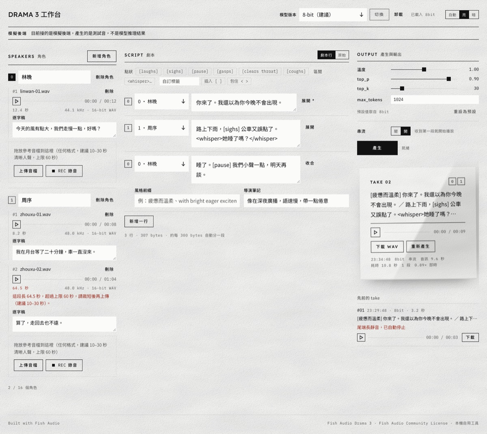
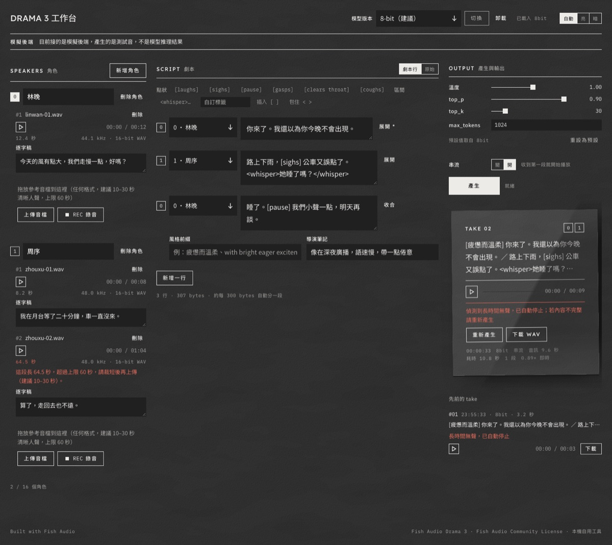

# drama-3 — Fish Audio Drama 3 本機 TTS 工作台

在 Apple Silicon Mac 上以圖形介面操作 [Fish Audio Drama 3](https://huggingface.co/fishaudio/drama-3) 文字轉語音模型：
多角色、聲音複製、表演標籤、長文串流，全程本機、離線、不花錢。
後端以 FastAPI 薄封裝 [mlx-audio](https://github.com/Blaizzy/mlx-audio)，前端是 Vite + React 的「紙張與墨」工作台。





> 截圖為接「模擬後端」時的畫面，音訊是測試音；真模型畫面相同，只是沒有頂端的橫幅。

---

## ⚠️ 先讀這段：模型是非正式版，而且會中斷

1. **本專案跑的不是 Fish Audio 官方推理**。官方只支援 NVIDIA GPU（SGLang-Omni / fish-speech），Mac 無法執行。
   這裡用的是社群把權重轉成 MLX 格式的版本（`mlx-community/fish-audio-drama-3-{4bit,8bit,bf16}`），
   由 [stickerdaniel](https://huggingface.co/stickerdaniel) 轉換，**Fish Audio 未釋出也未背書**。
2. **mlx-audio 對 Drama 3 的支援還沒進正式 release**。本專案鎖在 2026-10-14 的 git commit（見 `server/pyproject.toml`），
   上游之後的變動不保證相容。
3. **產生到一半會沒聲音，這是模型本身的行為**，三個版本都會發生，不是本專案的程式造成的。
   實測（2026-10-15，合成語音當參考）：

   | 情境 | 中斷率 |
   |---|---|
   | 一句塞 5 個表演標籤 | 4bit 3/3、8bit 2/3、bf16 3/3 |
   | 無參考音檔的一般句子 | 8bit 3 次中 1 次 |
   | 一般有參考音檔的句子 | 偶發 |

   中斷的樣子不是音訊變短，而是講幾秒後轉成靜音，一路拖到長度上限。後端會偵測「出聲後連續 6 秒無聲」或「開頭 6 秒沒出聲」就主動停止並提示**重新產生**，
   通常重試一次就過。降低中斷率的做法：一行只放 1 到 2 個標籤、給參考音檔、句子短一點。
4. 未經本人同意複製真人聲音是授權條款明文禁止的行為，請只用自己的聲音或已取得同意的錄音。

---

## 能做什麼

| 能力 | 說明 |
|---|---|
| 聲音複製 | 每個角色上傳或錄製 10–30 秒參考音檔加逐字稿，可多段；沒有參考音檔則由模型自行配音 |
| 多角色劇本 | 最多 16 個角色，逐行指定角色，不用手打 `<\|speaker:N\|>` 標籤 |
| 表演控制 | 點狀標籤 `[laughs]` `[sighs]` `[pause]`、區間標籤 `<whisper>…</whisper>`、整句風格前綴、導演筆記 |
| 跨語言 | 參考音檔與台詞語言可不同，83 種語言 |
| 長文與串流 | 自動分段、前段當後段上下文；串流模式收到第一段就開始播放 |
| 版本切換 | 4bit / 8bit / bf16 三個量化版本，一次載入一個，取樣參數隨版本換預設 |
| 輸出 | 每次產生一張 take 卡紙，可播放、下載 WAV、重新產生；保留先前 12 張 |

不做的事（移植版沒有或需要改第三方碼）：修改 take、局部 infilling、固定種子、變速、角色描述代替音檔。

---

## 架構

```
瀏覽器 (Vite :5173) ──/api proxy──▶ FastAPI (:8793) ──▶ mlx-audio ──▶ MLX / Metal ──▶ models/
```

- `frontend/`：Vite + React 19、純 CSS、Oxlint；字型以 @fontsource 隨前端打包，離線可用。
- `server/`：Python 3.12 + FastAPI，由 uv 管理；只呼叫 mlx-audio 的公開 API，不改第三方碼。
  MLX 推理固定在一條常駐執行緒；一把鎖共用產生與載入，忙碌時回 409 不排隊；每次產生結束清 MLX 快取。
- `MOCK=1` 啟動後端可在沒有模型時開發前端，回傳測試音。

詳細規格見 `spec/`（架構、模型能力與控制語法、API 契約），操作手冊見 `docs/ops.md`。

---

## 需求

- Apple Silicon Mac。實測機器：M5 Max、128 GB 統一記憶體。
- 記憶體看「行程峰值」而不是權重大小（產生中 MLX 快取會再多 28–30 GB）：

  | 版本 | 磁碟 | 行程峰值 | 載入（熱） | 即時倍率 | 備註 |
  |---|---|---|---|---|---|
  | 4bit | 22 GB | 55 GB | 0.7 秒 | 2.1x | 最快，標籤密集句最不穩 |
  | 8bit | 39 GB | 72 GB | 1.4 秒 | 1.8x | **建議預設** |
  | bf16 | 67 GB | 103 GB | 8.6 秒 | 1.3x | 128 GB 機器會到記憶體警告 |

- Homebrew、Node 20+、uv（setup.sh 會自動裝）、Python 3.12（優先用 Homebrew 既有的）。
- 下載三個版本合計約 131 GB，可只下載其中一個。

---

## 快速開始

```bash
# 1. 後端環境（可重複執行）
bash server/setup.sh

# 2. 下載模型（擇一或全部；大檔，中斷可續傳）
bash models/download.sh 8bit

# 3. 啟動後端（:8793）；沒有模型時改 MOCK=1 bash server/run-server.sh
bash server/run-server.sh

# 4. 另開終端啟動前端（:5173）
cd frontend && npm install && npm run dev
```

開 http://localhost:5173 ，頁首選版本按「載入」，左欄建角色、中欄寫劇本、右欄按「產生」。
關閉、查詢、換埠、常見狀況見 [docs/ops.md](docs/ops.md)。

---

## 已知限制

- 中斷偵測抓不到「出聲之後才轉成低音量雜訊」的失敗，會拖到長度上限（約 47 秒）。
- 麥克風錄音功能未在自動化測試中驗證（瀏覽器窗格無法授權麥克風）。
- 同一段文字每次結果不同，沒有固定種子。
- 載入秒數為檔案已在系統快取的熱載入，冷讀會更久。

---

## 來源與致謝

| 元件 | 來源 | 授權 |
|---|---|---|
| Drama 3 模型（原版） | Fish Audio，[fishaudio/drama-3](https://huggingface.co/fishaudio/drama-3)；[技術報告 arXiv:2610.18010](https://arxiv.org/abs/2610.18010) | [Fish Audio Community License](https://huggingface.co/fishaudio/drama-3/blob/main/LICENSE) |
| MLX 量化權重（非官方） | [mlx-community/fish-audio-drama-3-4bit](https://huggingface.co/mlx-community/fish-audio-drama-3-4bit)、[-8bit](https://huggingface.co/mlx-community/fish-audio-drama-3-8bit)、[-bf16](https://huggingface.co/mlx-community/fish-audio-drama-3-bf16)，由 stickerdaniel 轉換 | 沿用 Fish Audio Community License |
| mlx-audio | Prince Canuma，[Blaizzy/mlx-audio](https://github.com/Blaizzy/mlx-audio)（Drama 3 支援由 stickerdaniel 貢獻，PR #1018） | MIT |
| MLX | Apple，[ml-explore/mlx](https://github.com/ml-explore/mlx) | MIT |
| FastAPI、uvicorn、python-multipart、numpy、huggingface_hub | 各專案 | MIT / BSD / Apache 2.0 |
| React、Vite、Oxlint | Meta、VoidZero | MIT |
| 字型 | [Lexend](https://fonts.google.com/specimen/Lexend)、[Noto Sans TC](https://fonts.google.com/noto/specimen/Noto+Sans+TC)、[IBM Plex Mono](https://github.com/IBM/plex)，經 [@fontsource](https://fontsource.org/) 打包 | SIL OFL 1.1 |
| 設計指南格式 | [google-labs-code/design.md](https://github.com/google-labs-code/design.md) | Apache 2.0 |

本專案與 Fish Audio、Apple、mlx-audio 專案皆無隸屬關係。**Built with Fish Audio.**

### 授權

- 模型權重與輸出受 Fish Audio Community License 約束：年營收 50 萬美元以下可商用；對外提供 TTS 服務或 API 需另簽授權；
  禁止未經同意複製真人聲音；禁止用輸出訓練其他語音模型；須標示 Built with Fish Audio。本專案定位為本機自用工具。
- 本 repo 的程式碼授權尚未指定。

---

## 文件導覽

| 目錄 | 內容 |
|---|---|
| `spec/` | 架構、模型能力範圍與控制語法、API 契約（穩定規範） |
| `plan/` | 開發計畫：Epic 索引、各 Epic 的設計決策、任務、踩雷紀錄、實測數據 |
| `docs/ops.md` | 操作手冊：啟動、關閉、查詢、log、常見狀況 |
| `user/http/` | IDEA HTTP Client 測試請求 |
| `DESIGN.md`、`frontend/DESIGN.md` | 視覺設計指南：品牌層（紙張、窗光、凸版）與工作台層 |
